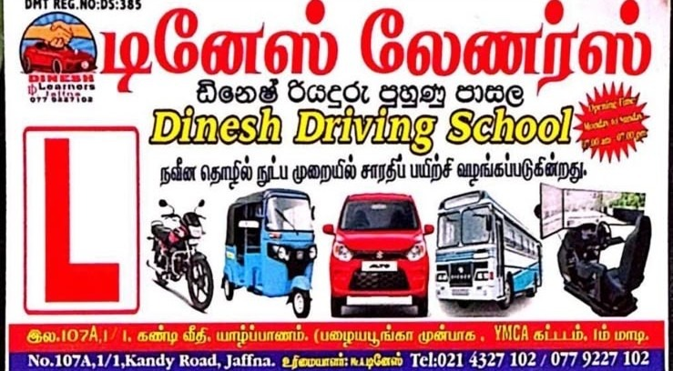

# Dinesh Learners & Driving School (DMT: DS:385) 🚗

> **யாழ்ப்பாணத்தின் முன்னணி நவீன தொழில் நுட்ப சாரதிப் பயிற்சி நிலையம்**  
> Jaffna's Leading Modern Driving Academy with 3D VR Simulator & Practical Dual-Control Fleet.  
> **දිනේෂ් රියදුරු පුහුණු පාසල • யாழ்ப்பாணம்**



---

## 🌟 Key Features

- **Iconic Branding:** DMT Registration No: **DS:385** (Govt Certified Driving School).
- **100% Trilingual Dynamic Switcher:** Instant zero-reload toggle between **தமிழ் (Tamil)**, **English**, and **සිංහල (Sinhala)** across the entire site.
- **Modern Fleet Training:**
  - 🚗 **Car (Auto & Manual):** Dual-control brake safety, Suzuki Alto/WagonR, dedicated Lady Instructors.
  - 🏍️ **Motorcycle & Scooter (Class A/A1):** Official DMT '8' track trial ground practice.
  - 🛺 **Three-Wheeler (Tuk-Tuk - Class B1):** City traffic driving and commercial license.
  - 🚌 **Heavy Vehicle (Bus & Lorry - Class D/CE):** Pneumatic air-brake and highway commercial driver training.
  - 🔥 **Combo Package:** Car + Bike + Medical exam assistance.
- **3D Virtual Cockpit Simulator:** Jaffna's first simulator for fear-free steering, clutch, weather & hazard perception.
- **Interactive Fee Estimator:** Dynamic price calculator with optional add-ons and transparent 2-installment plan.
- **Sri Lanka DMT Road Signs Mock Quiz:** Interactive quiz with instant visual feedback and highway code explanations.
- **Online Admission & WhatsApp Direct Integration:** Booking form generates formatted messages directly to WhatsApp (`+94 77 922 7102`).
- **Interactive Location Hub:** Embedded Google Map for YMCA Jaffna on Kandy Road opposite Old Park.

---

## 📂 Project Structure

```
learners/
├── index.html              # Main HTML5 Homepage (Tailwind CSS, FontAwesome, Google Fonts)
├── app.js                  # 100% Trilingual Dictionary (ta, en, si), Fee Calculator & Quiz Logic
├── style.css               # Glassmorphism, animations & typography styles
├── vercel.json             # Vercel deployment configuration
├── assets/
│   └── banner.jpg          # High-resolution official Dinesh Learners banner
└── README.md               # Project documentation
```

---

## 📍 Contact & Academy Information

- **Proprietor:** K. Dinesh (உரிமையாளர்: க. தினேஷ்)
- **Address:** No. 107A, 1/1, Kandy Road, Jaffna. (Opposite Old Park, YMCA Building, 1st Floor)
- **Phone:** 021 4327 102 / 077 9227 102
- **Operating Hours:** Monday to Sunday (All 7 Days): 7:00 AM – 7:00 PM
